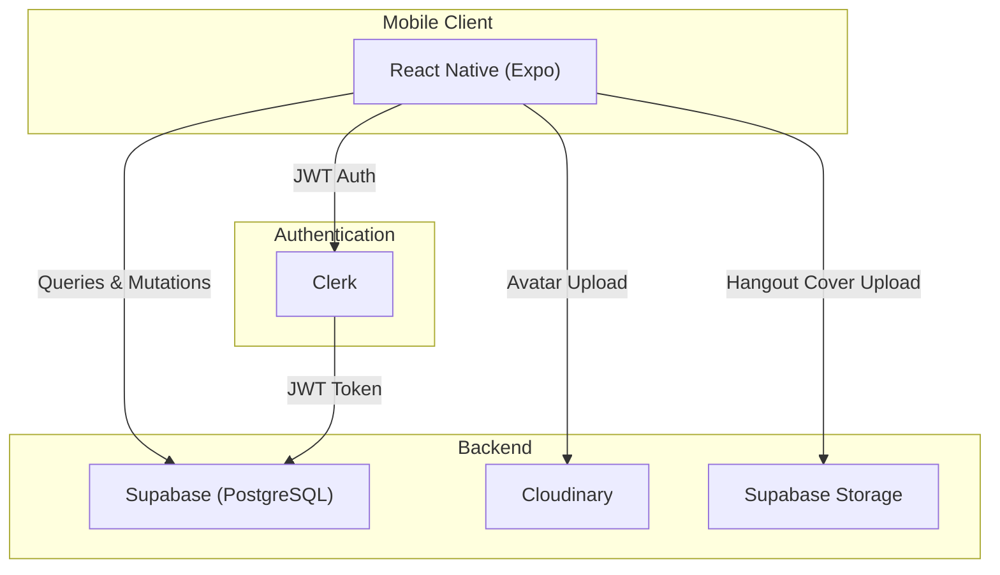
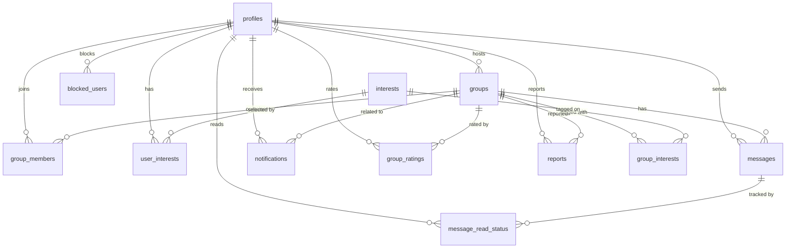

# HangoutBFF — Database Analysis

> [!NOTE]
> This document was reverse-engineered from the React Native codebase on 2026-11-24.
> Every table, column, and relationship listed below has evidence in the source code.

---

## 1. Architecture Overview

### Authentication Flow
1. **Clerk** handles all user authentication (email/password, Google OAuth).
2. On sign-up, the app calls `upsertProfile({ id: clerkUserId, firstName })` to create a Supabase profile.
3. For authenticated Supabase calls, the app creates a client via `createClerkSupabaseClient(token)` with the Clerk JWT in the `Authorization` header.
4. The `profiles.id` column stores the **Clerk user ID** (text, e.g. `user_2xAbc...`), **not** a Supabase `auth.users` UUID.

---

## 2. Discovered Tables

### 2.1 `profiles`
**Purpose:** Application user data, keyed by Clerk user ID.

| Column | Type | Constraints | Source Evidence |
|--------|------|-------------|-----------------|
| `id` | TEXT | PK | `upsertProfile({ id: params.id })` — Clerk user ID |
| `first_name` | TEXT | NOT NULL, DEFAULT '' | `upsertProfile`, `getProfile`, sender joins |
| `photo_url` | TEXT | nullable | `updateProfilePhoto`, sender joins |
| `bio` | TEXT | nullable | `updateProfileDetails`, `getProfile` |
| `gender` | TEXT | nullable | `updateProfileDetails`, `getProfile` |
| `city` | TEXT | nullable | `updateProfileDetails`, `getProfile` |
| `country` | TEXT | nullable | `updateProfileDetails`, `getProfile` |
| `rating_average` | NUMERIC | DEFAULT 0 | `getProfile` selects it |
| `groups_created_count` | INTEGER | DEFAULT 0 | `getProfile` selects it; triggers maintain it |
| `groups_joined_count` | INTEGER | DEFAULT 0 | `getProfile` selects it; triggers maintain it |
| `notification_token` | TEXT | nullable | `updateNotificationToken` |
| `is_active` | BOOLEAN | DEFAULT true | `getSuggestedPeople` filters by it |
| `is_blocked` | BOOLEAN | DEFAULT false | `getSuggestedPeople` filters by it |
| `created_at` | TIMESTAMPTZ | DEFAULT now() | Standard |
| `updated_at` | TIMESTAMPTZ | DEFAULT now() | Standard |

**Relationships:**
- Referenced as FK by: `groups.host_id`, `group_members.user_id`, `messages.sender_id`, `notifications.user_id`, `notifications.related_user_id`, `user_interests.user_id`, `blocked_users`, `reports`, `group_ratings`

---

### 2.2 `interests`
**Purpose:** Master list of interest categories.

| Column | Type | Constraints | Source Evidence |
|--------|------|-------------|-----------------|
| `id` | UUID | PK | `saveUserInterests` selects `id` |
| `category_name` | TEXT | UNIQUE, NOT NULL | `getInterests`, filtered by `in('category_name', ...)` |
| `created_at` | TIMESTAMPTZ | DEFAULT now() | Standard |

---

### 2.3 `user_interests`
**Purpose:** Junction: users ↔ interests.

| Column | Type | Constraints | Source Evidence |
|--------|------|-------------|-----------------|
| `id` | UUID | PK | Standard |
| `user_id` | TEXT | FK → profiles.id | `saveUserInterests`, `getSuggestedPeople` |
| `interest_id` | UUID | FK → interests.id | `saveUserInterests`, `getProfile` join |
| `created_at` | TIMESTAMPTZ | DEFAULT now() | Standard |

**Unique:** `(user_id, interest_id)`

---

### 2.4 `groups`
**Purpose:** The core "hangout" entity.

| Column | Type | Constraints | Source Evidence |
|--------|------|-------------|-----------------|
| `id` | UUID | PK | All queries: `.from("groups").select(...)` |
| `host_id` | TEXT | FK → profiles.id, NOT NULL | `createHangout`, `deleteHangout`, join `host:host_id(...)` |
| `title` | TEXT | NOT NULL | Insert + all selects |
| `description` | TEXT | nullable | Insert + search + detail |
| `activity_type` | TEXT | DEFAULT 'General' | `createHangout`, `getHangoutById`, `getMapHangouts` |
| `mood` | TEXT | nullable | `getHangoutById` selects it |
| `location_name` | TEXT | NOT NULL | Insert + all listing queries |
| `location_address` | TEXT | nullable | `getHangoutById` selects it |
| `location_lat` | DOUBLE PRECISION | NOT NULL | Insert + bounding box filters |
| `location_lng` | DOUBLE PRECISION | NOT NULL | Insert + bounding box filters |
| `scheduled_at` | TIMESTAMPTZ | NOT NULL | Insert + date filters + ordering |
| `max_participants` | INTEGER | DEFAULT 100 | Insert + capacity check |
| `current_participants` | INTEGER | DEFAULT 0 | Insert + all listing queries |
| `image_url` | TEXT | nullable | Insert + all listing queries |
| `status` | TEXT | DEFAULT 'active' | Filter `.eq("status", "active")`, values: active/full/cancelled/completed |
| `created_at` | TIMESTAMPTZ | DEFAULT now() | Standard |
| `updated_at` | TIMESTAMPTZ | DEFAULT now() | Standard |

---

### 2.5 `group_members`
**Purpose:** Membership of users in groups.

| Column | Type | Constraints | Source Evidence |
|--------|------|-------------|-----------------|
| `id` | UUID | PK | `checkMembership`, `joinHangout` |
| `group_id` | UUID | FK → groups.id | All membership queries |
| `user_id` | TEXT | FK → profiles.id | All membership queries |
| `role` | TEXT | CHECK IN ('host', 'member') | `joinHangout` inserts `'member'`; triggers insert `'host'` |
| `status` | TEXT | CHECK IN ('joined', 'left', 'removed') | `joinHangout`, `leaveHangout`, `removeMember` |
| `joined_at` | TIMESTAMPTZ | DEFAULT now() | Re-join sets it |
| `left_at` | TIMESTAMPTZ | nullable | `leaveHangout`, `removeMember` set it |
| `created_at` | TIMESTAMPTZ | DEFAULT now() | Standard |

**Unique:** `(group_id, user_id)`

---

### 2.6 `group_interests`
**Purpose:** Junction: groups ↔ interests.

| Column | Type | Constraints | Source Evidence |
|--------|------|-------------|-----------------|
| `id` | UUID | PK | Standard |
| `group_id` | UUID | FK → groups.id | `createHangout`, `deleteHangout`, nested selects |
| `interest_id` | UUID | FK → interests.id | `createHangout`, nested select `interests(category_name)` |
| `created_at` | TIMESTAMPTZ | DEFAULT now() | Standard |

**Unique:** `(group_id, interest_id)`

---

### 2.7 `messages`
**Purpose:** Group chat messages.

| Column | Type | Constraints | Source Evidence |
|--------|------|-------------|-----------------|
| `id` | UUID | PK | Select, read status |
| `group_id` | UUID | FK → groups.id | `sendMessage`, `getMessages`, realtime filter |
| `sender_id` | TEXT | FK → profiles.id | `sendMessage`, join `sender:sender_id(...)` |
| `content` | TEXT | NOT NULL | Insert + select |
| `message_type` | TEXT | DEFAULT 'text' | `sendMessage` defaults to 'text' |
| `is_deleted` | BOOLEAN | DEFAULT false | `getMessages` filters `.eq("is_deleted", false)` |
| `created_at` | TIMESTAMPTZ | DEFAULT now() | Ordering, timestamps |

---

### 2.8 `message_read_status`
**Purpose:** Per-user read receipts.

| Column | Type | Constraints | Source Evidence |
|--------|------|-------------|-----------------|
| `id` | UUID | PK | Standard |
| `message_id` | UUID | FK → messages.id | `markAsRead`, `getConversations` |
| `user_id` | TEXT | FK → profiles.id | `markAsRead` |
| `read_at` | TIMESTAMPTZ | DEFAULT now() | Standard |

**Unique:** `(message_id, user_id)` — explicit in `upsert({ onConflict: "message_id,user_id" })`

---

### 2.9 `notifications`
**Purpose:** In-app notification inbox.

| Column | Type | Constraints | Source Evidence |
|--------|------|-------------|-----------------|
| `id` | UUID | PK | `markNotificationRead` |
| `user_id` | TEXT | FK → profiles.id | `getNotifications`, `markAllNotificationsRead` |
| `type` | TEXT | NOT NULL | `getNotifications` selects it |
| `title` | TEXT | NOT NULL | Select |
| `body` | TEXT | nullable | Select |
| `is_read` | BOOLEAN | DEFAULT false | `getUnreadNotificationCount`, update |
| `related_group_id` | UUID | FK → groups.id, nullable | Select + join `related_group:related_group_id(...)` |
| `related_user_id` | TEXT | FK → profiles.id, nullable | Select + join `related_user:related_user_id(...)` |
| `sent_at` | TIMESTAMPTZ | DEFAULT now() | Ordering |
| `created_at` | TIMESTAMPTZ | DEFAULT now() | Standard |

---

### 2.10 `group_ratings`
**Purpose:** Ratings for completed hangouts.

| Column | Type | Constraints | Source Evidence |
|--------|------|-------------|-----------------|
| `id` | UUID | PK | Standard |
| `group_id` | UUID | FK → groups.id | `deleteHangout` deletes from it |
| `user_id` | TEXT | FK → profiles.id | Standard |
| `rating` | SMALLINT | CHECK 1–5 | Implied by `rating_average` |
| `comment` | TEXT | nullable | Standard |
| `created_at` | TIMESTAMPTZ | DEFAULT now() | Standard |

**Unique:** `(group_id, user_id)`

> [!NOTE]
> This table is only explicitly referenced in `deleteHangout()`, but is implied by the `rating_average` column on `profiles`.

---

### 2.11 `blocked_users`
**Purpose:** User-to-user blocks.

| Column | Type | Constraints | Source Evidence |
|--------|------|-------------|-----------------|
| `id` | UUID | PK | Standard |
| `blocker_id` | TEXT | FK → profiles.id | `getSuggestedPeople` queries `.eq("blocker_id", userId)` |
| `blocked_id` | TEXT | FK → profiles.id | `getSuggestedPeople` reads `blocked_id` |
| `created_at` | TIMESTAMPTZ | DEFAULT now() | Standard |

**Unique:** `(blocker_id, blocked_id)`

---

### 2.12 `reports`
**Purpose:** User-submitted reports.

| Column | Type | Constraints | Source Evidence |
|--------|------|-------------|-----------------|
| `id` | UUID | PK | Standard |
| `reporter_id` | TEXT | FK → profiles.id | Implied |
| `reported_group_id` | UUID | FK → groups.id, nullable | `deleteHangout` deletes `.eq("reported_group_id", groupId)` |
| `reported_user_id` | TEXT | FK → profiles.id, nullable | Implied |
| `reason` | TEXT | NOT NULL | Implied |
| `details` | TEXT | nullable | Implied |
| `status` | TEXT | DEFAULT 'pending' | Implied |
| `created_at` | TIMESTAMPTZ | DEFAULT now() | Standard |
| `updated_at` | TIMESTAMPTZ | DEFAULT now() | Standard |

---

## 3. Entity Relationship Diagram

---

## 4. Database Triggers

| Trigger | Table | Event | Function | Purpose |
|---------|-------|-------|----------|---------|
| `trigger_create_host_membership` | `groups` | AFTER INSERT | `fn_create_host_membership()` | Auto-creates host membership row |
| `trigger_update_group_participant_count` | `group_members` | AFTER INSERT/UPDATE/DELETE | `fn_update_group_participant_count()` | Keeps `groups.current_participants` in sync; toggles 'full'/'active' |
| `trigger_update_user_group_counts` | `group_members` | AFTER INSERT/UPDATE/DELETE | `fn_update_user_group_counts()` | Keeps `profiles.groups_created_count` and `groups_joined_count` in sync |
| `trg_profiles_updated_at` | `profiles` | BEFORE UPDATE | `set_updated_at()` | Auto-updates `updated_at` |
| `trg_groups_updated_at` | `groups` | BEFORE UPDATE | `set_updated_at()` | Auto-updates `updated_at` |
| `trg_reports_updated_at` | `reports` | BEFORE UPDATE | `set_updated_at()` | Auto-updates `updated_at` |

---

## 5. Storage Buckets

| Bucket | Public | Purpose | Used By |
|--------|--------|---------|---------|
| `hangout-images` | Yes | Hangout cover photos | `mutations/hangout.ts → uploadHangoutImage()` |

> [!NOTE]
> Avatar photos are uploaded to **Cloudinary**, not Supabase Storage. See `lib/cloudinary/uploadToCloudinary.ts`.

---

## 6. Realtime Subscriptions

| Channel Pattern | Table | Event | Filter | Used By |
|-----------------|-------|-------|--------|---------|
| `conversation-{groupId}` | `messages` | INSERT | `group_id=eq.{groupId}` | `conversation/[id].tsx` |
| `chat-list-realtime` | `messages` | INSERT | none | `(tabs)/chat.tsx` |

---

## 7. RLS Strategy

### Clerk JWT Integration
The app sends the current Clerk session token to Supabase through Supabase's `accessToken` callback. Clerk's native Supabase integration must be activated, and Clerk must be added as a third-party auth provider in Supabase. The token's `sub` claim contains the Clerk user ID, which `requesting_user_id()` extracts via `auth.jwt() ->> 'sub'`.

### Policy Summary

| Table | SELECT | INSERT | UPDATE | DELETE |
|-------|--------|--------|--------|--------|
| `profiles` | Public (all) | Own only | Own only | Own only |
| `interests` | Public | Service role only | — | — |
| `user_interests` | Public | Own only | — | Own only |
| `groups` | Public | Host must be self | Host only | Host only |
| `group_members` | Public | Self only | Self or host | Self or host |
| `group_interests` | Public | Host only | — | Host only |
| `messages` | Group members | Group members + self as sender | Sender or host | Host only |
| `message_read_status` | Own only | Own only | — | Own or host |
| `notifications` | Own only | Open (triggers/edge functions) | Own only | Own or related host |
| `group_ratings` | Public | Members of group | Own only | Own or host |
| `blocked_users` | Own only | Own only | — | Own only |
| `reports` | Own only | Own only | — | Own or related host |

---

## 8. Assumptions & Notes

1. **Saved Hangouts** are stored in `AsyncStorage` on the device (see `hooks/useSavedHangouts.ts`), NOT in the database.
2. The `interests` table is a **seed/lookup table** — the app reads from it but never creates new interests client-side.
3. **`group_ratings`** and **`reports`** tables are only directly referenced in `deleteHangout()` (cascade cleanup). The UI for creating ratings/reports may exist in future iterations or in code not yet written.
4. The `profiles.rating_average` field implies a mechanism (likely a trigger on `group_ratings`) to compute the average. This trigger is not explicitly referenced in the code but is a logical requirement.
5. The `notification_token` on `profiles` stores the **Expo Push Token** for push notifications.
